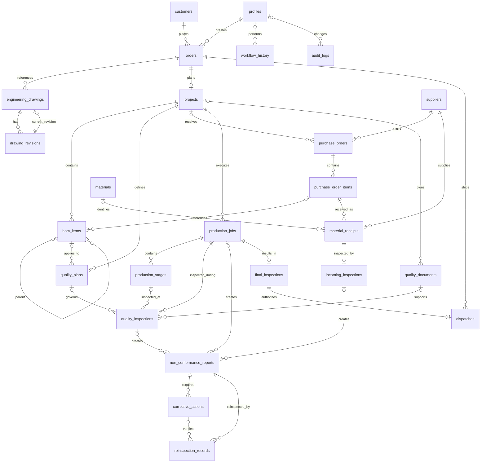

# JSPL Manufacturing and Quality Inspection Database

## Workflow coverage

The schema covers the nine-stage manufacturing workflow:

1. Customer order: `customers`, `orders`, `workflow_history`.
2. Engineering review: `engineering_drawings`, `drawing_revisions`.
3. Project planning: `projects`, `bom_items`.
4. Procurement: `suppliers`, `purchase_orders`, `purchase_order_items`, `quality_plans`.
5. Material receipt: `materials`, `material_receipts`.
6. Incoming inspection: `incoming_inspections`, `non_conformance_reports`.
7. Production: `production_jobs`, `production_stages`.
8. In-process quality: `quality_inspections`, `corrective_actions`, `reinspection_records`.
9. Final inspection and dispatch: `final_inspections`, `dispatches`.

`quality_documents` stores Supabase Storage references, while `workflow_history` retains every stage transition and `audit_logs` records record changes.

## Relationship explanation

- One customer can own many orders.
- One order can have many engineering drawings and one planned project.
- A drawing belongs to many revisions; its current revision is referenced by the drawing itself.
- A project owns BOM items and quality plans. BOM items can be nested through `parent_bom_item_id`.
- A supplier fulfills purchase orders containing ordered items.
- Purchase order items receive many material receipts. Receipt material identity is optional until the material master is matched.
- A receipt has one incoming inspection. Failed incoming material can produce one or more NCRs.
- A project has production jobs. Jobs contain ordered production stages.
- Quality plans can govern jobs and inspections. Inspection failures can generate NCRs.
- NCRs can have many corrective actions and reinspection records.
- A production job has one final inspection, which has at most one dispatch.
- Generic workflow history and audit records support entity references without creating circular foreign keys.

## ER diagram

